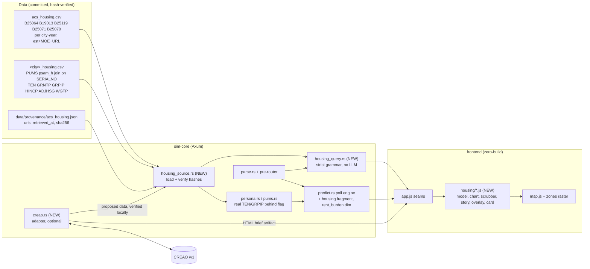
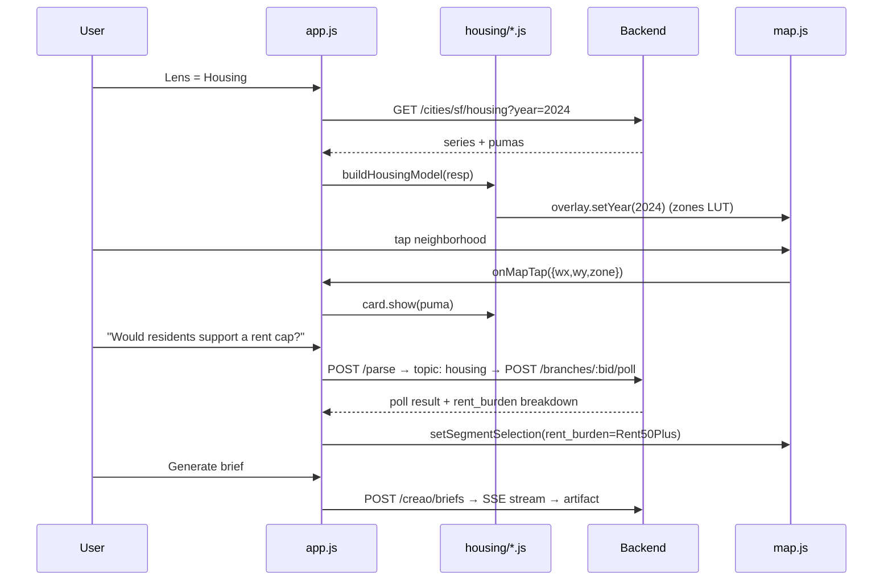
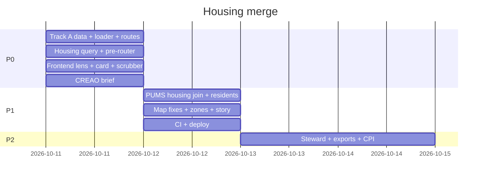

# Simtra × DataScape — Housing Merge Architecture Plan

**Status:** Core demo integrated locally; research integration pending · **Updated:** 2026-10-10 · **Current target repo:** `Mahin2076/datascape`
**Current integration candidate:** Cala for sourced housing research, subject to coverage verification.

## Current hackathon scope and three-person work split

This section supersedes the Simtra-first delivery plan below for the current hackathon. The earlier architecture, CREAO integration, estimates, and phases are retained as future reference, not requirements for these three branches. The current project is built in DataScape and borrows selected Simtra map and resident interactions.

### Main idea: Can You Afford to Stay?

An interactive housing-data world about how rent and income changes affect people living in a city. Explore a city overview, zoom into an illustrative walkable neighborhood, inspect buildings, and click residents to see their profiles, budgets, and responses to a housing scenario—including why they responded that way. Zoom back out to compare the bigger picture.

Real statistics, hypothetical household budgets, and simulated reactions must remain visibly distinct. A fictional building is not a property listing, a city median is not a neighborhood estimate, and a generated response is not testimony from a real resident.

### Feature scope

- Simtra-style city overview with housing patterns at the geographic resolution supported by the data.
- Connected zoom into DataScape-style street exploration and back out, preserving the selected city and scenario.
- Building inspection with rent statistics, historical changes, and source links.
- Clickable resident profiles showing illustrative household details, budget impact, response to the user's scenario, and an explanation.
- Scenario controls such as rent +10% or income +5%, with deterministic budget calculations separate from generated reactions.
- A personal budget view showing income, rent, and the amount remaining after rent (not a full disposable-income calculation).
- Timeline and cross-city comparisons using the existing housing features as a starting point.
- Cala research context with citations, after verifying coverage. Missing research must not prevent the core demo from working.

### Branch ownership

All three feature branches belong in `Mahin2076/datascape` and should start from the same agreed base commit. These are proposed branch names; the existing local `feature/p0` branch has not been renamed by this plan.

| Owner | Feature branch | Responsibilities | Owned files |
|---|---|---|---|
| Mahin | `feature/map-zoom` | City overview, zoom transitions, street movement, camera, building/character hit detection, final UI wiring | New `dist/map/` modules; shared `dist/app.js` and `dist/index.html` integration |
| Teammate 1 | `feature/resident-stories` | Resident profiles, budget cards, scenario controls, resident responses and explanations, illustrative/simulated labels | New `dist/residents/` modules and component styles |
| Teammate 2 | `feature/housing-data` | Housing datasets, pure calculations, timeline data, city comparisons, provenance, Cala coverage checks and backend research adapter | New `dist/data/` modules, `dist/assets/data.json`, and any new backend files outside `dist/` |

Each teammate should expose module functions rather than editing the shared app shell. Mahin owns integration changes to `dist/app.js`, `dist/index.html`, and shared `dist/style.css`; component styles can live beside their owning modules. Coordinate any exception before editing another person's files.

### Shared integration contracts

Agree on these contracts before implementation, then keep identifiers and units consistent across branches:

| Contract | Proposed behavior |
|---|---|
| Shared selection | `{ cityId, year, scenario: { rentChangePct, incomeChangePct } }`; percentage values use `10` for +10%, and `0` means no change |
| Resident selection | Map calls `onResidentSelect(residentId)`; the resident module resolves the profile and opens its panel |
| Housing access | Data module exposes `getHousing(cityId, year)` with monthly rent, annual household income, geography, estimate period, and source metadata |
| Budget calculation | Data module exposes `calculateBudget({ monthlyRent, annualIncome, rentChangePct, incomeChangePct })`; return monthly income, adjusted rent, remaining amount after rent, and rent-to-income ratio, with safe handling of unavailable or nonpositive income |
| Scenario changes | Resident controls emit selection changes; map and panels consume the same state so values stay synchronized |
| Research results | Cala adapter returns context with citations, dates, and explicit unavailable/error states; credentials remain server-side |
| Reaction results | Keep reaction text/explanation and generation method separate from sourced statistics; hand-authored demo responses must be labeled as scripted, not live AI |

The budget denominator must be an explicitly chosen or labeled illustrative household income. Do not imply that dividing two city medians measures the burden of a particular household. Detailed neighborhood coloring requires actual neighborhood data; otherwise display city-level figures and identify the street view as illustrative.

### Tasks and merge order

The integration branch combines the SF map, resident profiles, sourced housing access, scenario calculations, shared selection and app wiring. The core SF flow and all five cities' profile/scenario calculations have browser coverage; see `DEMO.md`. Reactions are scripted. Cala research (H6) remains unconfigured and unverified. Map and resident module boundaries are documented in their READMEs.

| ID | Owner | Task | Depends on | Acceptance evidence |
|---|---|---|---|---|
| H0 | All three | Agree on base commit, IDs, units, module exports, and a shared SF resident/data fixture | None | Each branch consumes the same documented fixture and contracts |
| H1 | Mahin | Build overview → zoom into street view → zoom back out | H0 | Browser walkthrough preserves city/year/scenario and supports walking at street level |
| H2 | Teammate 1 | Build profile, scenario controls, budget card, and response/explanation panel | H0 | Clicking a fixture resident opens the correct profile; changing the scenario updates the panel |
| H3 | Teammate 2 | Implement sourced housing access and budget/scenario calculations | H0 | Tests independently verify units, percentage changes, zero/missing income handling, and source metadata |
| H4 | Mahin, with teammates | Wire selection, resident click events, data, and scenario updates together | H1–H3 | One complete SF flow works without mismatched values or browser errors |
| H5 | Teammate 1 | Connect the agreed reaction implementation | H2, H3 | Selected resident's explanation matches the current scenario; scripted versus AI behavior is disclosed |
| H6 | Teammate 2 | Test Cala housing coverage, add backend adapter/cache and research results | H3 | Relevant query returns inspectable citations; unavailable service leaves core exploration usable; no API key in browser files |
| H7 | All three | Extend the proven flow across cities and available years | H4 | City/year changes update map, resident context, budget, and sources consistently |

Merge the shared contracts/data foundation first, then map and resident modules, then app-shell wiring. Add research after the core flow works. Treat any live AI reaction service as an explicit integration dependency; copying Simtra's panel alone does not provide its backend.

### First-demo milestone

**San Francisco overview → zoom into an illustrative neighborhood → walk around → click a resident → apply rent +10% → see the calculated budget impact and the resident's labeled reaction/explanation → zoom back out.**

Deliver this complete path before expanding city coverage or adding Cala. Keep citations reachable, avoid using future information in historical scenarios, and distinguish working features from mocked or scripted demo behavior during handoff.

---

## TL;DR

Simtra simulates how a city's residents react. DataScape shows where rent is outpacing income. Neither is complete alone: simtra has no real housing data (resident tenure is a coin flip weighted by poverty ratio), and datascape has real Census numbers but no people.

The merged product adds a **Housing lens** to simtra:

1. **Observed:** real ACS rent, income and rent-burden numbers per city and neighborhood (PUMA), 2021–2024, with margins of error and Census source links. Deterministic, no LLM.
2. **Simulated:** every synthetic resident gets their *real* household housing record from the PUMS housing file (tenure, gross rent, rent as % of income). Ask "What if rent goes up 10%?" and see which residents break, broken down by rent burden.
3. **CREAO:** a server-triggered "Census data steward" agent that fetches and packages new ACS releases (simtra verifies before using), plus a "housing analyst" agent that turns a result into a shareable interactive HTML brief.

**3-minute demo:** open SF → story mode plays 2021→2024, neighborhoods recolor by rent burden → tap the Mission → card shows median rent ± MOE with Census links → ask "Would residents support a 10% rent increase cap?" → residents light up on the map, breakdown shows severely burdened renters vs owners → click "Generate brief" → CREAO streams an HTML report.

---

## 1. Context

### What each project does best

| | Simtra | DataScape |
|---|---|---|
| Strength | Real-city maps, PWGTP-weighted synthetic residents from ACS PUMS, LLM polling with CIs and 14 demographic breakdowns, A/B tests, counterfactuals, verified no-LLM `/data-query` with hash-checked provenance, Neo4j memory workspaces | Clear single-question story ("where is rent outpacing income?"), timeline scrubber, fixed-scale growth bars, inspection card with MOE + source links, honest caveat copy |
| Data | ACS 2023 1-year PUMS **person** file only (18 cols, `crates/sim-core/src/pums.rs:23`) | 20 place-level ACS 5-year records (B25064 rent, B19013 income, B01003, B25002), all 60 values verified against Census `.dat` files |
| Weak spot | No rent/income-dollars/rent-burden data; `Agent.homeowner` is simulated by a logistic in `persona.rs:195` | No people, fictional world, paid art not in repo (fresh clone doesn't boot), Q&A mis-ranks answers, compares overlapping 5-year periods, gap coloring ignores MOE |

### What must NOT carry over from DataScape

- `ask()` ranking bug (filters rent>income before ranking "fastest"; answers "lowest rent" with "widest gap").
- Binary coral/teal gap coloring that ignores MOE (Chicago 2024: +0.7pp vs ~±2.1pp MOE).
- Comparing overlapping 5-year releases (2017–21 vs 2020–24).
- Using all-household median income as the affordability denominator (makes SF look "most affordable").
- Boot dependency on paid LimeZu atlases; dead/hidden UI (controls hint, minimap, touchpad).

### Thesis

**Observed facts and simulated reactions, side by side, never blended.** Real Census numbers say *what is*. Simulated residents (grounded in their real housing records) say *how people might react*. Every number on screen is labeled with its evidence class.

---

## 2. Goals, non-goals, success criteria

**Goals**
- G1. Deterministic housing facts (rent, income, burden, growth) per city and per PUMA, 2021–2024, with MOE + provenance.
- G2. Residents carry real PUMS household housing attributes behind a feature flag, without changing existing poll outputs.
- G3. Housing questions route deterministically when factual, to the poll engine when opinion.
- G4. Housing lens UI: story mode, year scrubber, PUMA choropleth, inspection card, rent-burden breakdowns.
- G5. CREAO integration that's visible in the demo and never a single point of failure.
- G6. Demo cannot fail: offline fixture mode, deployable backend, CI.

**Non-goals (v1)**
- Building-level data or per-building inspection (needs a building index; phase 3).
- Adding Austin/Seattle as full simulated cities (shown as observed-only comparison rows).
- Causal claims ("rent rose *because*…"). Forecasting future rents.

**Success criteria**
- `cargo test --workspace` green incl. new `housing_query`, `housing_source`, hash-tamper tests.
- `validate` headline score unchanged (±0.00) with `SIMTRA_HOUSING_PERSONAS=0`; reported separately with `=1`.
- Every observed number in the UI traces to a manifest row with a census.gov URL and sha256.
- PUMS-derived citywide renter rent-burden share within published B25070 90% MOE (sanity check, per city).
- Demo runs end-to-end with network off via `?demo=1`.

---

## 3. Architecture overview



### Component inventory

| Component | Location | Status | Area |
|---|---|---|---|
| ACS table series | `crates/sim-core/data/verified/acs_housing.csv` | NEW | Data |
| PUMS housing join | `crates/sim-core/data/verified/<slug>_housing.csv` | NEW | Data |
| Housing manifest | `data/provenance/acs_housing.json` | NEW | Data |
| Table verifier | `crates/sim-core/tools/verify_acs_tables.py` | NEW | Data |
| PUMS verifier | `crates/sim-core/tools/verify_pums.py:104` | CHANGE (keep extra housing cols in a separate file) | Data |
| Housing loader | `crates/sim-core/src/housing_source.rs` | NEW (sibling of `data_source.rs`) | Backend |
| Housing query | `crates/sim-core/src/housing_query.rs` | NEW (sibling of `data_query.rs`) | Backend |
| Routes | `crates/sim-core/src/api.rs:85-128`, root list `:254-274` | CHANGE | Backend |
| Pre-router | `api.rs:1767-1806` (`parse_question_handler`) | CHANGE | Backend |
| Resident housing | `pums.rs:29`, `persona.rs:151,195`, `predict.rs:223-245,548-557,1317-1378` | CHANGE (flagged) | Backend |
| Filters | `api.rs:328-405` (`PopulationFilters`), `:1642-1661` | CHANGE | Backend |
| CREAO adapter | `crates/sim-core/src/creao.rs` | NEW (mirrors `rocketride.rs`) | Backend |
| Evidence | `crates/sim-core/src/evidence.rs:67,90` | CHANGE (new class, fix tenure text) | Backend |
| Housing frontend | `frontend/src/housing/{model,chart,scrubber,story,overlay,card}.js` | NEW | Frontend |
| App seams | `frontend/src/app.js:94-106,210-235,1175,1183` | CHANGE (small) | Frontend |
| Zones raster | `crates/sim-maps/src/bin/export_zones.rs` → `frontend/assets/<slug>_zones.{png,json}` | NEW | Maps |
| CI | `.github/workflows/ci.yml` | NEW | Ops |

---

## 4. Data architecture

### 4.1 Two data tracks

**Track A: table-level ACS series (observed, city level).** Powers the story, timeline, city comparison and city card.

| Table | Variable | Why |
|---|---|---|
| B25064 | Median gross rent | Headline rent |
| B19013 | Median household income (all households) | Kept for comparison with DataScape |
| **B25119** | Median household income by tenure → **renter** households | Correct denominator for rent affordability |
| **B25071** | Median gross rent as % of household income | Measured rent burden, replaces the `12×rent/income` proxy |
| **B25070** | Gross rent as % of income, brackets | Share of renters ≥30% and ≥50% (burdened / severely burdened) |
| B25002 | Occupancy (vacancy) | Context, kept from DataScape |

**1-year vs 5-year decision: use ACS 1-year for 2021, 2022, 2023, 2024.** All five simtra cities (and Austin/Seattle) exceed the 65k population threshold, so 1-year estimates exist. Census guidance says not to compare overlapping 5-year periods; 1-year releases don't overlap. Cost: larger MOE, which is handled honestly by §4.4. Note: the 2020 1-year release was experimental, so the series starts at 2021. Keep the DataScape 5-year values as an optional "smoothed" toggle, labeled as overlapping.

**Track B: PUMS housing-file join (resident level).** Powers resident attributes, PUMA choropleth and rent-burden breakdowns. `verify_pums.py` already downloads and hashes `psam_hXX.csv` but discards everything except PUMA/TEN/TYPEHUGQ (`verify_pums.py:104`). Extend it to also write a **separate** file so the frozen `<slug>_context.csv` hash and header assert (`data_source.rs:127`) stay untouched:

```
crates/sim-core/data/verified/<slug>_housing.csv
SERIALNO,TEN,GRNTP,GRPIP,HINCP,ADJHSG,ADJINC,WGTP,NP,BDSP,YBL,MV
```

- `GRPIP` = gross rent as % of household income (101 = 101%+). `HINCP × ADJINC/1e6` = household income in survey-year dollars.
- One row per household (SERIALNO), joined to persons on SERIALNO. GQ persons (TYPEHUGQ≠1) have no housing row → housing fields `None`.
- Household-level stats use **WGTP** (household weight), not PWGTP.
- Same vintage as the person file (2023 1-year). A second vintage (2021) is optional for PUMA-level change maps.

### 4.2 Files and schemas

`crates/sim-core/data/verified/acs_housing.csv`
```
city_slug,geo_level,geoid,geo_label,year,series,table_id,variable,estimate,moe,release_date,source_url
sf,place,0667000,San Francisco city,2024,acs1,B25064,B25064_001E,<estimate>,<moe>,2025-09-11,https://api.census.gov/data/2024/acs/acs1?get=B25064_001E,B25064_001M&for=place:67000&in=state:06
```
(Values illustrative. Real values come from the verifier.)

`data/provenance/acs_housing.json`
```json
{
  "schema_version": 1,
  "series": "acs1",
  "tables": ["B25064","B19013","B25119","B25071","B25070","B25002"],
  "retrieved_at": "2026-10-10T00:00:00Z",
  "snapshot_path": "crates/sim-core/data/verified/acs_housing.csv",
  "snapshot_sha256": "<sha256>",
  "requests": [{"url": "https://api.census.gov/data/2024/acs/acs1?...", "sha256": "<response sha256>"}],
  "geographies": {"sf": {"level":"place","geoid":"0667000"}, "cybercago": {"level":"place","geoid":"1714000"}},
  "verification_status": "Verified"
}
```
Embedded at compile time with `include_str!` like `data_source.rs:7`. Each `<slug>_housing.csv` gets its sha256 added to the existing `acs_pums.json` city entry (`housing_snapshot_sha256`).

### 4.3 Geography reconciliation

| simtra slug | Simulated population geography | Track A geography | Note |
|---|---|---|---|
| sf | SF County (8 PUMAs) = city | place 0667000 | exact match |
| neu_york | 5 boroughs (55 PUMAs) = city | place 3651000 | exact match |
| cybercago | **Cook County** (36 PUMAs) | place 1714000 **and** county 17031 | show city place for story; residents span suburbs: label it |
| synth_la | **LA County** (71 PUMAs) | county 06037 (+ place 0644000) | label "LA County" on resident views |
| simami | Miami-Dade + Monroe (25 PUMAs) | county 12086 (+ place 1245000) | label county |
| austin, seattle | none | place 4805000, 5363000 | **observed-only** comparison rows |

Rule: any card that mixes observed and simulated numbers states both geographies.

### 4.4 MOE, significance, CPI

- **Derived ratio MOE** (Census approximation): for `R = X/Y`, `MOE_R = sqrt(MOE_X² + R²·MOE_Y²) / Y`.
- **Growth** `g = X₂/X₁ − 1` uses the same formula on `X₂/X₁`.
- **Gap** (rent growth − income growth): `MOE_gap = sqrt(MOE_gr² + MOE_gi²)`.
- **Significance:** `|gap| > MOE_gap` (90%) → colored coral/teal; otherwise **gray "too close to call"**. This replaces DataScape's binary coloring.
- **CPI:** store nominal values; show a "real dollars" toggle using CPI-U annual averages (BLS series CUUR0000SA0), stored in `data/provenance/cpi_u.json`. Rent-vs-income gap is inflation-neutral, so the headline gap doesn't need CPI.
- **PUMA-level (Track B) estimates** have no published MOE. Compute 90% CIs with the 80 PUMS replicate weights (`WGTP1..80`, successive-difference formula `SE = sqrt(4/80 · Σ(θr − θ)²)`) if we keep replicate columns; otherwise label "no MOE (PUMS sample)" and gray out PUMAs with <100 unweighted renter households.

### 4.5 Validation against published tables

`tests/housing_crosscheck.rs` (NEW): PUMS-weighted citywide share of renters with GRPIP ≥ 30 must fall inside the B25070-derived share ± MOE for SF and NYC (exact-geography cities). Prints the comparison for the county-level cities without failing.

---

## 5. Evidence model

| Class | Source | Example | Render |
|---|---|---|---|
| `verified` (existing, schema 1.0) | `/data-query`, PUMS person-weight tabulations | "Tenure distribution" | existing `verified-data.js` bars |
| `sourced_observation` (NEW) | Published ACS tables | "Median gross rent 2024: $X ± $MOE" | housing chart/card, census.gov links, MOE always shown |
| `observed_estimate` (NEW) | PUMS housing-file tabulation | "Mission PUMA renters ≥30% burdened: 41%" | choropleth, card, "PUMS sample" label |
| `simulated_estimate` (existing, `evidence.rs:67`) | LLM poll | "62% support a rent cap" | existing poll result + CI |

Rules:
- The frozen schema 1.0 is **not touched**. Housing queries return `query_spec.mode = "verified_table"` and the frontend dispatches on `mode` (`app.js` `runVerifiedQuery` ~l.1116, `feedpanel.js:928` `mountVerifiedChart`). `buildVerifiedDataModel` keeps failing closed on non-1.0 shapes.
- Every number on screen carries a small class chip: **Census** / **Census sample** / **Simulated**.
- Fix `evidence.rs:90` and `data_query.rs:522-523` limitation text once tenure becomes real (flag on).
- CREAO output is never `verified`. It is `agent_generated` until simtra's verifier accepts it (§8.2).

---

## 6. Backend design

### 6.1 `housing_source.rs` (NEW)

```rust
pub struct HousingSeriesRow { pub city: String, pub geo_level: GeoLevel, pub geoid: String,
  pub year: u16, pub table_id: String, pub variable: String, pub estimate: f64,
  pub moe: Option<f64>, pub release_date: NaiveDate, pub source_url: String }
pub struct HousingHousehold { pub serialno: String, pub ten: Option<u8>, pub grntp: Option<u32>,
  pub grpip: Option<u8>, pub hincp: Option<f64>, pub wgtp: u32, pub bdsp: Option<u8>, pub ybl: Option<u8> }
pub fn load_series(root: &Path) -> Result<Vec<HousingSeriesRow>, SourceError>   // sha256 check vs manifest
pub fn load_households(root: &Path, slug: &str) -> Result<HashMap<String, HousingHousehold>, SourceError>
```
Same failure behavior as `data_source::load` (`data_source.rs:45`): any hash mismatch → `verification_status: "Unknown"`, endpoints return `unavailable`, never numbers.

### 6.2 `housing_query.rs` (NEW): deterministic answers

Strict full-string grammar (pattern of `data_query::parse_question`, `data_query.rs:258-366`), `#[serde(deny_unknown_fields)]`:

| Intent | Example phrasings | Answer |
|---|---|---|
| `rent_series` | "Show median rent over time [in <city>]" | B25064 2021–2024 ± MOE |
| `income_series` | "Show renter income over time" | B25119 renter |
| `burden` | "What share of renters are rent-burdened [in <city>]?" | B25070 ≥30%, ≥50% |
| `gap` | "Where is rent outpacing income?" | per city gap ± MOE, significance flag, **ranked by gap over all cities** |
| `fastest_rent` | "Where did rent rise fastest?" | ranked by rent growth over **all** cities (fixes DataScape bug) |
| `income_pace` | "Where did income keep pace?" | cities with gap ≤ 0 or not significant |
| `extreme_rent` | "Which city has the highest/lowest rent?" | ranked rent |
| `puma_burden` | "Which neighborhoods are most rent-burdened in <city>?" | Track B, WGTP-weighted |

Unsupported → `status: "unsupported"` with examples, **never a number** (forecasts, "rent in 2027", unknown cities, injected instructions).

### 6.3 Routes

| Method | Path | Notes |
|---|---|---|
| `GET` | `/cities/:city/housing?year=2024` | city series + PUMA table (Track A + B), `sourced_observation` / `observed_estimate` |
| `GET` | `/housing/compare?year=2024` | all cities incl. observed-only Austin/Seattle |
| `POST` | `/housing-query` | `{question, city?}` → `verified_table` response |
| `POST` | `/branches/:bid/poll` | **unchanged route**; accepts optional `"topic":"housing"` in `poll_from_json` (`api.rs:1575`) |
| `POST` | `/creao/briefs` | start housing-analyst run → `{job_id}` |
| `GET` | `/creao/briefs/:job_id/stream` | SSE proxy of CREAO NDJSON |
| `GET` | `/creao/briefs/:job_id/artifact` | cached HTML, strict CSP, sandbox |
| `POST` | `/creao/webhook/:token` | CREAO terminal notification (per-run unguessable token) |
| `POST` | `/admin/data/refresh` | trigger data-steward run (admin token) |
| `GET` | `/health` | adds `housing: {verification_status, vintage}`, `creao: {configured, credits_available, hourly_cap_exceeded}` |

Each new route is registered in 4 places: router (`api.rs:91-126`), root list (`api.rs:254-273`), `INTEGRATION.md`, `tests/contract.rs:96` `contract_all_endpoints`.

Example `GET /cities/sf/housing?year=2024` (shape):
```json
{
  "city": "sf", "year": 2024, "series": "acs1",
  "evidence": {"claim_class": "sourced_observation", "provider": "U.S. Census Bureau ACS",
               "manifest_sha256": "…", "verification_status": "Verified"},
  "city_level": {
    "median_gross_rent": {"estimate": 0, "moe": 0, "source_url": "https://api.census.gov/…"},
    "median_renter_income": {"estimate": 0, "moe": 0, "source_url": "…"},
    "rent_pct_income": {"estimate": 0, "moe": 0, "source_url": "…"},
    "renters_burdened_30": {"share": 0.0, "moe": 0.0},
    "growth_since_2021": {"rent": 0.0, "renter_income": 0.0, "gap": 0.0, "gap_moe": 0.0, "significant": false}
  },
  "pumas": [{"puma": "07507", "label": "…", "renter_share": 0.0, "median_grntp": 0,
             "burdened_30": 0.0, "n_renter_households": 0, "claim_class": "observed_estimate"}],
  "limitations": ["1-year ACS estimates; PUMA values are PUMS sample tabulations without published MOE", "Nominal dollars"]
}
```

### 6.4 Routing housing questions

Order in `parse_question_handler` (`api.rs:1767-1806`), before RocketRide/LLM:
1. `data_query::parse_question` (existing verified).
2. `housing_query::parse_question` (NEW). On match return `ParsedQuestion{ route: "housing_query", … }`.
3. Else RocketRide (if configured) → local LLM router (`parse.rs:44`), with the router prompt (`parse.rs:50-72`) taught to tag `topic: "housing"` for rent/affordability/eviction **opinion** questions.

Frontend: replace keyword routing with a call to `/parse` first. **Do not** add a bare `rent` regex ahead of `VERIFIED_QUESTION` (`app.js:1175`); "Would residents support rent control?" is an opinion poll, not a fact.

### 6.5 Residents with real housing (flag `SIMTRA_HOUSING_PERSONAS`, default off until validated)

- `PumsRecord` (`pums.rs:29`) gains `housing: Option<HousingHousehold>` joined on `serialno` at load (`load_city`, `pums.rs:300`).
- `persona.rs:195` `sample_homeowner`: when `ten` present, owner = `TEN ∈ {1,2}`. **Keep the `rng.gen::<f64>()` draw anyway** so every later draw (values noise, names, home/work cells, lifestyle) is unchanged. Fall back to the logistic when missing.
- `Agent` gains `rent_burden: RentBurden` = `Own | RentLt30 | Rent30to50 | Rent50Plus | NoCashRent | Unknown`, plus `gross_rent: Option<u32>`.
- **Prompt stability:** do *not* edit `build_persona_prose` for all polls. For `topic == "housing"` polls only, append a fragment at the per-representative prose assembly (`predict.rs:548-557`):
  `" Housing: rents; gross rent ~$2,400/mo (~38% of household income)."`
  Non-housing polls stay byte-identical → prompt cache keys and rubric baselines unchanged.
- **Archetypes:** for housing polls, add the burden band to `archetype_key_level` (`predict.rs:223-245`) at levels 0–1 so burden heterogeneity survives clustering (members inherit the representative's answer, `predict.rs:752-763`). Watch `MAX_CLUSTERS=160`.
- **Breakdowns:** add `rent_burden` to `DEMO_DIMENSIONS` (`predict.rs:1317`) with canonical order; `contract.rs` checks length dynamically. Update frontend dimension lists.
- **Filters:** `PopulationFilters` (`api.rs:328-405`, `deny_unknown_fields`) gains `tenure` and `rent_burden`; `filter_matches` (`api.rs:1642`) already handles tenure.
- **Lifestyle:** `lifestyle.rs:182-190` spending sentence uses GRPIP when known (no RNG).
- **City context:** `CityProfile`/`PoliticsProfile` (`city.rs:56-72`) gain optional `housing_facts` (SF rent ordinance, NYC rent stabilization, Chicago/LA/Miami context) with `#[serde(default)]`, injected only for housing polls, dated ≤ `as_of_date` (leakage rule, AGENTS.md §13).

### 6.6 Housing scenarios

Use existing `run_counterfactual(pop, &Poll, Event, &TestTag)` (`predict.rs:964`) with housing events, e.g. `{"kind":"housing","text":"Your rent increases 10% next month"}`. The base and exposed results plus delta come with the `rent_burden` breakdown, so the "who breaks?" moment is a delta chart by burden band. Seed surveys: add a housing scenario to `memory.rs` `SEED_SURVEYS` (`:477-482`) so a fresh workspace opens on it.

### 6.7 Persistence and lineage

`/housing-query` answers are recorded through `memory.rs` `record_data_query` (`:1358-1389`) as `DataQuery` with an extra `mode` property, so the feed panel can filter and replay them. No schema migration. Poll results keep going to InsForge `prediction_results`.

---

## 7. Frontend design

### 7.1 Flow



### 7.2 Modules (all NEW, pure where possible, `app.js` gets seams only; it's already 2,265 lines)

| Module | Exports | Notes |
|---|---|---|
| `housing/model.js` | `buildHousingModel(resp)` | fail-closed like `buildVerifiedDataModel`: required fields, https `*.census.gov` sources, nonnegative numbers, MOE present for `sourced_observation` |
| `housing/chart.js` | `renderHousingChart(model,{year})`, `bindHousingChart(host,…)` | inline SVG reusing `.pc-*` classes from `persona-chart.js`; rent vs renter-income lines with MOE bands; fixed shared scale (DataScape idea) |
| `housing/scrubber.js` | `createYearScrubber({years,onChange})` | `role=radiogroup`; persist `?lens=housing&year=` via `workspace.shareUrl` keep list (`workspace.js:50`). Don't call it "timeline" (feed panel uses that word) |
| `housing/story.js` | `createHousingStory(hooks)` | reuses `tour.js` callout mechanics (`tour.js:24-37`); steps drive `onSelectCity`, `map.zoomTo`, `setSegmentSelection`, `setYear` |
| `housing/overlay.js` | `createZoneOverlay(map,{zonesSrc})` | decodes `<slug>_zones.png` like `_buildLandMask` (`map.js:401-431`), recolors via per-year LUT, draws between base and sprites |
| `housing/card.js` | `showHousingCard(zone)` | modeled on `showCharCard` (`app.js:2135`): median rent ± MOE, renter income, burden share, 2021→2024 trend, sources, "area median, not an asking price" disclaimer, "show residents here" button |

### 7.3 App seams (small edits)

- Mode button: `index.html:129-132` `.ask-modes` + `ASK_MODE_LABEL/PLACEHOLDER` (`app.js:210-235`) + dispatch in `runPrediction` (`app.js:1183`).
- State: `state.lens`, `state.housing {year, model, storyStep}` (`app.js:94-106`); reset in `onSelectCity` (`app.js:938-970`).
- Result card: `showHousingResult(model)` modeled on `showVerifiedResult` (`app.js:1131-1165`), disposer registered like `verified.dispose` (`app.js:244-252`).
- Map: new `onMapTap({wx,wy,lon,lat,zone})` in pointer-end tap branch (`map.js:564-584`) before `onEmptyTap`.
- Feed: `feedpanel.js:31` VIEWS gains `['housing','Housing']`; `openChart` (`:864-874`) dispatches on `response.query_spec.mode`.
- Manual: 5th `.manual-step` "Afford" in `index.html:213-265`.

### 7.4 Story mode (DataScape's best idea, fixed)

1. SF 2021: "Both start at zero." Neighborhoods colored by renter burden.
2. Scrub to 2024: rent vs renter-income lines diverge; gap shown **with MOE band**.
3. Compare cities: ranked gap table, gray rows for "too close to call" (Chicago likely lands here).
4. Zoom to the most-burdened PUMA → card.
5. Hand-off: "Now ask the residents." Pre-filled poll: "Would you support capping annual rent increases at 5%?"

### 7.5 Design, mobile, a11y

- Simtra design system (white cards, `#007aff` accent); burden scale uses a sequential palette validated for color-blind contrast; gray = not significant.
- Mobile: card becomes a bottom sheet; scrubber is full-width; overlay legend collapses into a chip.
- Keyboard: scrubber arrow keys; Escape closes card/story; story steps announced via `aria-live`.
- Breakpoints tested: 375, 768, 1024, 1440.

---

## 8. CREAO integration

CREAO keys stay server-side ("not a client-side JavaScript API"). The browser only talks to simtra.

### 8.1 Adapter: `crates/sim-core/src/creao.rs` (NEW, mirrors `rocketride.rs`)

```rust
pub struct CreaoClient { http: reqwest::Client, key: String, base: String /* https://developer.creao.ai */,
  model: String /* pinned, e.g. "anthropic/claude-haiku-4-5" */, steward_agent: Option<Uuid>, analyst_agent: Option<Uuid> }
impl CreaoClient {
  pub fn from_env() -> Option<Self>; // None unless CREAO_API_KEY set → feature hidden
  pub async fn usage(&self) -> Result<Usage>;                 // GET /v1/account/usage
  pub async fn start_run(&self, agent: Uuid, input: Value, webhook: Option<Url>) -> Result<RunId>; // POST /v1/runs
  pub async fn stream_run(&self, agent: Uuid, input: Value) -> Result<impl Stream<Item=Event>>;   // POST /v1/realtime/runs (NDJSON)
  pub async fn get_run(&self, id: &RunId) -> Result<Run>;     // GET /v1/runs/{id} (source of truth, artifact URLs)
}
```
- Request structs use `#[serde(skip_serializing_if = "Option::is_none")]`: CREAO rejects unknown fields and nulls (400 `INVALID_INPUT`).
- Always send `model` explicitly (docs conflict on the default).
- Timeouts: connect 5s; first `output_text.delta` within 20s or abort → fallback.
- Errors branch on `error` code (`RATE_LIMITED` honors `Retry-After`; `INSUFFICIENT_CREDITS` hides feature).
- `GET /health` reports `creao.configured`, `credits.available`, `hourly_cap_exceeded`.

**Job table** (`state.db`, NEW `creao_jobs`): `job_id, kind, input_hash, run_id, status, webhook_token, artifact_path, credits, model, created_at`. Gives idempotency (CREAO has no idempotency keys) and caches by `input_hash` so repeat demo clicks cost zero credits.

**Rate budget:** 30 req/min per account *including polling*. Prefer realtime streams; poll at 5–10s with backoff only for async steward runs.

### 8.2 Role 1: Census Data Steward (CREAO proposes, simtra verifies)

- **Trigger:** `POST /admin/data/refresh` or a server-side cron (CREAO schedules are UI-only, Pro Plus). Calls `POST /v1/runs {agent_id: steward, input: {cities, years:[2021..2024], tables:["B25064","B19013","B25119","B25071","B25070"]}, model, webhook_url: https://<backend>/creao/webhook/<token>}`.
- **Agent:** built once in CREAO from a working chat so the fetch script is bundled as a reference file; it calls api.census.gov and outputs `acs_housing.csv` + receipt JSON as an artifact.
- **On webhook:** ignore the body except `runId` (webhooks are unsigned); `GET /v1/runs/{id}` → download `result.artifacts[].url` immediately (short-lived) → run `verify_acs_tables.py --check` locally: schema, MOE present, `source_url` host `api.census.gov`, years, numeric sanity, **re-fetch a random 10% sample directly from Census and compare** → only then write a *staged* manifest. Promotion to committed data is a human-reviewed PR. Record `run_id`, model, credits in the manifest `retrieved_by` field.
- **Fallback:** committed snapshot + `verify_acs_tables.py --download`. CREAO never blocks startup.
- **Demo value:** "When Census publishes 2025 data next September, a CREAO agent packages it and simtra verifies it before anyone sees it."

### 8.3 Role 2: Housing Analyst brief (the visible one)

- **Trigger:** "Generate brief" on a housing result → `POST /creao/briefs {city, year, poll_result_id}`.
- **Backend:** builds input ≤256 KB `{city, year, housing_series, poll_summary, breakdown_rent_burden, caveats}` → `POST /v1/realtime/runs` → proxies NDJSON (`todo.updated`, `output_text.delta`, `artifact.created`, `run.completed`) to the browser as SSE on `/creao/briefs/:job/stream`. On completion `GET /v1/runs/{id}` → download HTML artifact → cache under `briefs/<input_hash>.html`.
- **Serving:** `GET /creao/briefs/:job/artifact` with `Content-Security-Policy: default-src 'none'; style-src 'unsafe-inline'; img-src data:` and rendered in `<iframe sandbox>` (no `allow-same-origin`, no scripts unless reviewed). Agent HTML is untrusted.
- **Labeling:** brief header stamped "Generated by CREAO agent · includes simulated estimates · source data: Census ACS (links)".
- **Fallback:** local deterministic brief from the same chart modules (print-friendly HTML); button disabled with tooltip when `/health` shows CREAO unavailable.

### 8.4 Role 3: Exports (Sheets / Notion / Slack)

One "exporter" agent with a Google Sheets connector (OAuth once in CREAO UI; Free plan allows 1 personal connector per agent app), `write_autonomy: full_auto` via `PATCH /v1/agents/{id}`. Input `{destination, title, rows}`; link parsed from `result.text`. **Fallback:** CSV/JSON download from simtra. Nice-to-have, not demo-critical.

### 8.5 Not doing: Super Agent as router

Allowlist-gated (403 `SUPER_AGENT_ACCESS_DENIED`), sandboxed runs with no latency SLA. Unsuitable as a synchronous question router. The local router and RocketRide stay primary.

### 8.6 Cost and setup

| Item | Free plan | Pro ($20/mo, 200 credits) |
|---|---|---|
| Agent creation (3 agents) | uses most of 30 starter credits | fine |
| Brief run (Haiku/Gemini Flash) | ~0.1–1 credit each | ~200+ briefs |
| Steward run | ~1–3 credits | fine |
| Recommendation | Rehearse on cached briefs; buy Pro for demo day | ✓ |

**Runbook:** create `cr_sk_` key (Developer Console → API Keys) → set fly secrets `CREAO_API_KEY`, `CREAO_MODEL`, `CREAO_STEWARD_AGENT_ID`, `CREAO_ANALYST_AGENT_ID`, `CREAO_WEBHOOK_BASE` → build agents in CREAO UI → `curl /health` shows `creao.configured: true` → pre-generate demo briefs (cached).

### 8.7 Extension slot: second data sponsor

If the other sponsor ("the data thing") is a data platform, it plugs in with the same pattern: `crates/sim-core/src/<sponsor>.rs` with `from_env()`, timeouts, fallback, health reporting, and a role that **feeds the verifier, never bypasses it** (e.g. hosting the ACS snapshot/warehouse, or serving PUMA tabulations). Fill in once the sponsor is confirmed.

---

## 9. Map work

**Prerequisites (fix before any overlay):**
1. **North–south chunk mirror:** `sim-core/geo.rs` and `tools/compute_centroids.py` count chunk `cy` from the north; `tiles.db` counts from the south. 3–13 non-SF PUMA centroids sit on water. Fix and recompute centroids in `data/cities/*.toml`.
2. **Resident offset (115–310 m):** `map.js` `lonlatToWorld` (`:343-349`) uses a linear lon/lat bbox. Port the forward transverse Mercator from `geo.rs` to JS using `bbox_utm`/`chunks_x/y` exposed via `/cities` (`api.rs:2381`) or `assets/<slug>_manifest.json`.
3. `app.js:560` forces `setSatellite(true)`; make satellite opt-in (also removes an Esri attribution dependency).

**Zones raster (NEW):** `crates/sim-maps/src/bin/export_zones.rs` reads TIGER 2020 PUMA polygons (same source as `compute_centroids.py`), reprojects with `crs::new_proj`, rasterizes a zone index per LOD-4 pixel → `frontend/assets/<slug>_zones.png` (same size and north-up flip as `<slug>_tiles.png`, index in R+G) + `<slug>_zones.json` legend. Pixel-aligned with the art; year change = LUT swap only.

**Later (phase 3):** building sidecar index (`osm.rs` pass2 → NEW `building_index` table with osm_id, kind, levels, puma) + detail tile pyramid for building-scale zoom. Keeps `tiles.db` bytes and V6 baselines intact (`crates/sim-maps/INTEGRATION.md:429`).

**DataScape's walk mechanic:** optional player avatar (existing sprite sheet, WASD on the canvas, `_isLand` collision) that inspects the nearest PUMA landmark. Nice-to-have after the card works by tap.

---

## 10. Quality

**Rust tests (NEW):**
- `tests/housing_source.rs`: hash-tamper (flip byte, null each provenance field) → `Unknown`, never numbers.
- `tests/housing_query.rs`: independent recomputation of growth, gap, MOE from CSV; every grammar intent; unsupported questions never return numbers; **ranking regression tests for DataScape's bugs** (fastest rent ranks all cities; lowest rent ≠ widest gap).
- `tests/housing_crosscheck.rs`: PUMS burden share vs B25070 (§4.5).
- `tests/persona_determinism.rs`: with flag off, population + prompts byte-identical to a committed golden hash; with flag on, only housing polls change.
- `tests/contract.rs`: new routes in `contract_all_endpoints`.
- `tests/creao_adapter.rs`: mock server: unknown-field rejection, 429 Retry-After, `run.failed`, webhook dedupe on `X-Creao-Delivery-Id`, re-fetch as source of truth, disabled when env unset.

**Frontend tests:** `frontend/tests/housing-model.test.mjs` (fail-closed, escaping, no mutation), `housing-story.test.mjs` (reducer), Playwright smoke at 375/768/1024/1440 on `?demo=1` fixtures. Note: existing browser scripts look stale against the current DOM; refresh them first.

**Validate:** `validate` with flag off must match the current headline exactly. Optional `rubric_housing_sf.yaml` using housing contests already referenced (SF Prop 33 at `rubric.yaml:72`, March 2024 Prop A affordable-housing bond, NYC rent-stabilization CF), with no certified results in descriptions.

**CI (NEW `.github/workflows/ci.yml`):** `cargo test --workspace`, `node --test frontend/tests/*.test.mjs`, `python3 crates/sim-core/tools/verify_acs_tables.py --check` (offline hash check), Playwright smoke. No model key in CI; `validate --smoke` stays local.

**Budgets:** `/cities/:city/housing` < 50 ms (in-memory), housing JSON < 50 KB per city, zones PNG < 300 KB, overlay redraw < 4 ms/frame.

---

## 11. Deploy & ops

| Problem | Fix |
|---|---|
| Dockerfile can't build main: `include_str!("data/provenance/acs_pums.json")` not copied in builder | COPY `data/provenance` in builder (`Dockerfile:7-13`) |
| Runtime lacks verified CSVs (`/data-query` resolves vs `current_dir`, `api.rs:159`) | COPY `crates/sim-core/data/verified` into runtime at same relative path (`Dockerfile:24-28`) |
| `fly.toml` targets upstream app `sf-digital-twin-tp` | create team fly app, update `fly.toml` |
| Hosted frontend points at an ngrok tunnel (`frontend/backend-config.js`) | point at team fly URL |
| Hooks only run with `core.hooksPath .githooks` | CI is the gate; document hook setup |

**Env vars (new):** `SIMTRA_HOUSING_PERSONAS` (0/1), `CREAO_API_KEY`, `CREAO_MODEL`, `CREAO_STEWARD_AGENT_ID`, `CREAO_ANALYST_AGENT_ID`, `CREAO_WEBHOOK_BASE`, `SIMTRA_ADMIN_TOKEN`.

**Demo/offline mode:** `frontend/data/housing.json` + `frontend/fixtures/housing-*.json` served static; `api.js` `demoRequest` (`api.js:239-278`) gains housing branches; one cached CREAO brief in fixtures. `?demo=1` works with no network.

**Observability:** structured log line per housing query (intent, city, ms), per CREAO run (job, run_id, credits, latency, fallback used).

---

## 12. Security, privacy, licensing

- **CORS** is `*` today. Keep for public read routes; `/admin/*` requires `SIMTRA_ADMIN_TOKEN`; `/creao/briefs` rate-limited per workspace (`X-Simtra-Workspace`) to protect credits.
- **Keys** server-side only (CREAO, model). Never in `backend-config.js`.
- **Untrusted HTML** from CREAO: CSP + sandboxed iframe (§8.3).
- **Webhooks:** per-run token in path, dedupe, re-fetch run (no signatures documented).
- **Licensing:**
  - **LimeZu-derived atlases and tile PNGs are committed in simtra's public repo.** Check the LimeZu license terms; if redistribution of derived atlases isn't allowed, move them to a private artifact store and fetch at build/deploy (same lesson as DataScape's gitignored atlases, minus the boot failure).
  - Add credits to the About modal (`index.html:213-265`): OpenStreetMap contributors (ODbL), USGS 3DEP, Esri (if satellite kept), LimeZu, route1rodent sprites CC BY-SA 3.0 (`assets/SPRITES-LICENSE.txt`), U.S. Census Bureau.
  - Census data is public domain; PUMS has no PII.

---

## 13. Delivery plan

**Branch:** `feature/housing` in simtra, PRs per phase, no direct pushes to main (the repo has had 12 direct merges to main; stop that for this work).

| Phase | Scope | Owner area | Est. | Depends on |
|---|---|---|---|---|
| **P0 Demo-critical (day 1)** | Track A data + `verify_acs_tables.py` + `housing_source.rs` + `/cities/:city/housing` + `/housing/compare` + `housing/{model,chart,scrubber,card}.js` + Housing mode button + demo fixtures + Dockerfile fix | Data, Backend, Frontend | 12–16 h | none |
| **P0 cont. (day 1)** | `housing_query.rs` grammar + pre-router + ranking regression tests | Backend | 4–6 h | Track A |
| **P0 cont. (day 1)** | CREAO analyst brief (adapter, SSE proxy, artifact serving, cached fallback) | Backend, Frontend | 6–8 h | P0 routes |
| **P1 (day 2)** | Track B PUMS housing join + flagged resident housing + `rent_burden` dimension/filters + housing counterfactual + determinism tests | Data, Backend | 10–14 h | Track A |
| **P1 (day 2)** | Map fixes (chunk mirror, georeference) + zones raster + overlay + story mode | Maps, Frontend | 10–12 h | none for fixes |
| **P1 (day 2)** | CI workflow, fly app + frontend config, credits/licensing | Ops | 4–6 h | none |
| **P2** | CREAO data steward + staged verification, exports agent, CPI toggle, replicate-weight MOE for PUMAs | Backend, Data | 10–14 h | P1 |
| **P3** | Building index + detail tiles + walkable avatar inspection; Austin/Seattle as full cities (optional) | Maps | 20+ h | P1 |

**Demo cut line:** everything in P0 plus story mode. If day 2 slips, the demo uses city-level housing + tap card + poll with existing (simulated) tenure breakdown + CREAO brief.



**DataScape repo after merge:** keep as a static story site with no paid-art boot dependency (fall back to simple drawn shapes when atlases are missing), fix the documented Q&A bugs, link to simtra's Housing lens, then archive once simtra ships.

---

## 14. Demo script (3 minutes)

| Time | Beat | Fallback |
|---|---|---|
| 0:00 | "Where is rent outpacing income? And what happens to the people living it?" Open simtra SF, Housing lens. | `?demo=1` fixtures |
| 0:20 | Story mode: scrub 2021→2024; lines diverge with MOE band; neighborhoods recolor | static screenshots in deck |
| 0:50 | City comparison: ranked gap; Chicago gray "too close to call" (honesty moment) | — |
| 1:10 | Tap the most-burdened PUMA → card: rent ± MOE, renter income, % burdened, Census links | — |
| 1:30 | Ask "Would you support capping annual rent increases at 5%?" → residents react on map; breakdown by rent burden | cached poll result (prompt cache) |
| 2:05 | Counterfactual "rent +10%": delta by burden band, severely burdened renters flip | cached |
| 2:30 | "Generate brief" → CREAO streams, HTML brief appears | pre-generated cached brief |
| 2:50 | Close: observed vs simulated chips; "every Census number links to its source" | — |

---

## 15. Risks & mitigations

| Risk | L | I | Mitigation |
|---|---|---|---|
| Housing persona change moves rubric scores | M | H | Feature flag, keep RNG draws, housing-only prompt fragment, golden-hash test |
| 1-year MOE makes most gaps "not significant" | M | M | That's the honest result; story leans on burden levels (large, significant) rather than tiny growth gaps |
| Geography mismatch (Cook/LA County vs city) confuses judges | M | M | Explicit geography labels on every card |
| CREAO latency/credits fail live | M | M | Cached briefs keyed by input hash, health preflight, button hidden when unavailable |
| Map overlay misaligned | H (until fixed) | H | Fix mirror + georeference first; zones raster is pixel-aligned by construction |
| Deploy broken day-of | M | H | Fix Dockerfile in P0, demo mode as backup |
| LimeZu license exposure | M | M | Verify terms; move derived art out of public repo if needed |
| Simtra push access (doc author has read-only) | — | L | PRs from forks; owner merges |

**Decisions needed (with recommendation):**
1. 1-year vs 5-year ACS → **1-year** (non-overlapping), 5-year as optional smoothed view.
2. Austin/Seattle → **observed-only rows** in v1.
3. Flag default for resident housing → **off** until validate non-regression is confirmed, then on.
4. CREAO plan → **Pro** for demo day.
5. Second data sponsor → confirm name; slot in §8.7.

---

## 16. Honest limits

- ACS 1-year estimates carry sampling error; small year-to-year gaps are often not significant and are shown as such.
- PUMA values come from PUMS sample tabulations, not published tables; MOE is computed only if replicate weights are kept.
- LA, Chicago and Miami resident populations are county-level; their observed series are city-level unless labeled otherwise.
- Dollar values are nominal unless the CPI toggle is on.
- Rent-vs-income divergence is descriptive, not causal.
- Simulated reactions are model-based estimates (`model_based_unvalidated`), not survey results.
- CREAO-generated briefs are agent output; they summarize, they don't verify.

---

## Appendix A: Existing code referenced

| Area | Path |
|---|---|
| Router / state | `crates/sim-core/src/api.rs:85-128`, `:2404-2482` (`build_state`), `:2457` (city slugs) |
| Verified data | `crates/sim-core/src/data_query.rs:258-366,375`, `data_source.rs:7,45,127`, `DATA_QUERY.md` |
| Poll engine | `crates/sim-core/src/predict.rs:223-245,443,548-557,752-763,964,1317-1378` |
| Personas / PUMS | `crates/sim-core/src/persona.rs:151,195,267,359`, `pums.rs:23,29,171,300` |
| Evidence | `crates/sim-core/src/evidence.rs:67,90` |
| Routing | `crates/sim-core/src/parse.rs:44,50-72`, `rocketride.rs:24` |
| Memory | `crates/sim-core/src/memory.rs:477-482,1358-1389` |
| Frontend | `frontend/src/app.js:94-106,210-235,560,1131-1165,1175,1183,2135`, `map.js:343-349,401-431,564-584`, `feedpanel.js:31,864-874,928`, `tour.js:24-37`, `workspace.js:50`, `api.js:239-278` |
| Data tools | `crates/sim-core/tools/verify_pums.py:104`, `data/provenance/acs_pums.json` |
| Deploy | `Dockerfile`, `fly.toml`, `vercel.json`, `frontend/backend-config.js`, `.githooks/pre-push` |

Line numbers are from simtra `main` at `7a4ed26`.

## Appendix B: References

- Census, comparing ACS data / overlapping 5-year periods: https://www.census.gov/programs-surveys/acs/guidance/comparing-acs-data.html
- Census, ACS MOE and derived-estimate formulas: https://www.census.gov/programs-surveys/acs/guidance/statistical-testing-tool.html
- PUMS data dictionary (TEN, GRNTP, GRPIP, HINCP, ADJHSG, WGTP): https://www.census.gov/programs-surveys/acs/microdata/documentation.html
- Census API (acs1): https://api.census.gov/data/2024/acs/acs1
- CREAO Developer API: https://agent.docs.creao.ai/developer-api/overview · runs: `/developer-api/runs/create-async-run`, `/create-realtime-run` · streaming events: `/developer-api/streaming-events` · webhooks: `/developer-api/webhooks` · rate limits: `/developer-api/rate-limits` · usage: `/developer-api/account/get-account-usage`
